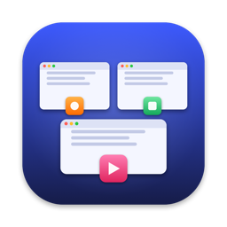

<p align="center">
  
</p>

# Glance

**See which app every window belongs to in Mission Control.** Glance puts each
app's icon on its window thumbnails in macOS Mission Control, and lets you close
a window straight from the overview with a middle-click, a three-finger click or Cmd+W,
or quit its app with Cmd+Q.

- **App icons on thumbnails:** each window in Mission Control gets its app's icon,
  centred on the thumbnail's bottom edge, fading in as Mission Control opens.
- **Close from Mission Control:** middle-click a thumbnail, click it with three
  fingers on the trackpad, or hover over it and press Cmd+W, to close that window
  without leaving the overview.
- **Quit from Mission Control:** hover over a thumbnail and press Cmd+Q to quit that
  window's app. Apps quit normally, so they can still save or ask first. Finder is the
  exception: it stays running.
- **Settings window:** open Glance from Applications, Raycast or Alfred to change its
  settings, with or without the menu bar icon.
- **Lightweight:** no Dock icon and no network access.

Runs on macOS 14 Sonoma, 15 Sequoia and 26 Tahoe, on Apple Silicon and Intel.

## Install

1. Download the latest `Glance-vX.Y.Z.dmg` from [Releases](../../releases/latest).
2. Open the DMG and drag **Glance** into **Applications**.
3. Open Glance. Because it isn't notarized by Apple yet, macOS blocks the first launch:
   go to **System Settings → Privacy & Security**, scroll down and click **Open Anyway**.
   (Or run `xattr -dr com.apple.quarantine /Applications/Glance.app` in Terminal.)
4. When asked, allow Glance in **System Settings → Privacy & Security → Accessibility**.
5. Open Mission Control.

Turn on **Launch at login** in the settings window to keep it running.

### Why Accessibility?

macOS has no public API for Mission Control. Glance uses the Accessibility API to
read where the Dock draws each window thumbnail and to press a window's close
button, and an event tap to see clicks and keystrokes while Mission Control is open.
The tap is off the rest of the time, and Glance only looks for its own shortcuts: it
never records what you type. Everything stays on your Mac; Glance makes no network
requests.

## Usage

| In Mission Control | Does |
|---|---|
| Middle-click a thumbnail | Closes that window, with all its tabs |
| Three-finger click a thumbnail | Closes that window, with all its tabs |
| Hover over a thumbnail and press Cmd+W | Closes that window, with all its tabs |
| Hover over a thumbnail and press Cmd+Q | Quits that window's app (does nothing on Finder) |

Opening Glance shows its settings window, whichever way you open it, except when it
starts at login. There you can hide the app icons or the menu bar icon, turn on
Launch at login, quit Glance, and open the log (`~/Library/Logs/Glance.log`) if
something misbehaves. The menu bar icon offers the same, plus a shortcut to the window.
Hiding the icon forgets its place in the menu bar, so it comes back in the default spot.

Three-finger clicks are read from the trackpad through Apple's private
MultitouchSupport framework. If "Look up & data detectors" or three-finger drag is
set to use three fingers, macOS may take the gesture first.

## Build from source

Requires Xcode command line tools (Swift 5.9 or later). No Xcode project needed.

```sh
./build.sh                 # build/Glance.app (universal: arm64 + x86_64)
./scripts/install.sh       # build, install into /Applications, and launch
./scripts/make-dmg.sh      # build/Glance.dmg
./scripts/smoke-test.sh build/Glance.dmg
./scripts/make-icns.sh     # regenerate Resources/AppIcon.icns from scripts/make-icon.swift
```

Local builds are ad-hoc signed, so macOS asks for Accessibility again after each rebuild.

## How it works

- **Detecting Mission Control:** while it's open, the Dock's Accessibility tree gains a
  group (`mc`) whose buttons are the window thumbnails, with their titles and frames.
- **Matching windows:** thumbnails are matched to real windows by title, through each
  running app's own Accessibility tree. Untitled thumbnails go to the untitled window
  closest to their shape.
- **Drawing icons:** small borderless panels at a very high window level sit above the
  Mission Control surface and ignore the mouse.
- **Closing windows:** Mission Control swallows clicks before other windows see them, so a
  session event tap (only enabled while Mission Control is open) hit-tests clicks, and the
  cursor position when Cmd+W is pressed, against the thumbnails and presses the window's
  close button. Keystrokes away from a thumbnail pass through untouched.
- **Closing tabbed windows:** a window's close button only closes its active tab, so Glance
  repeats it until every tab is gone. The next tab can show for a moment as it closes.
- **Quitting apps:** Cmd+Q is hit-tested the same way, then the app gets a normal quit
  request rather than a force quit, so it can save or prompt. Finder has no Quit by default
  and quitting it leaves the desktop without one, so Glance consumes the keystroke on a
  Finder thumbnail and does nothing, which also stops it quitting the frontmost app.

The event-tap approach follows [CloseUp](https://github.com/oomol-lab/CloseUp), which adds
window controls to Mission Control and is worth a look if you want more actions.

## Releasing

Push a version tag; CI builds the universal DMG, smoke-tests it on every supported macOS
version and chip, and publishes a GitHub Release:

```sh
git tag v1.0.0 && git push origin v1.0.0
```

## License

[GPL-3.0](LICENSE)
